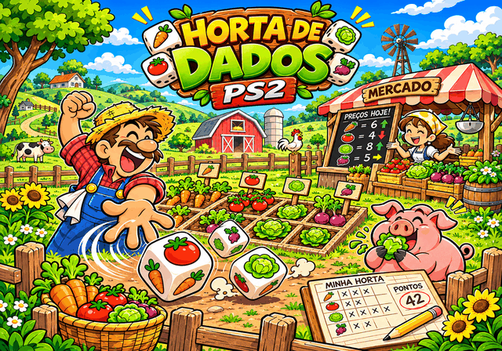
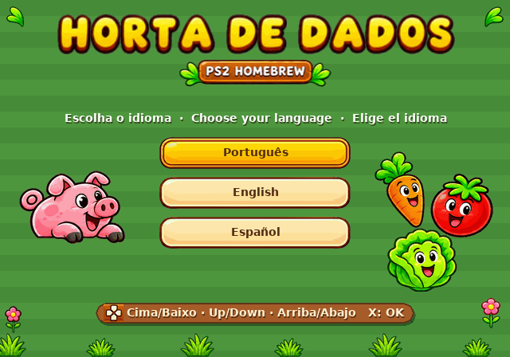
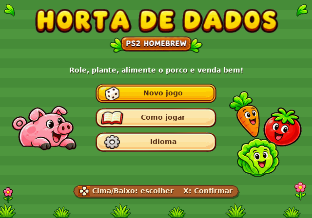
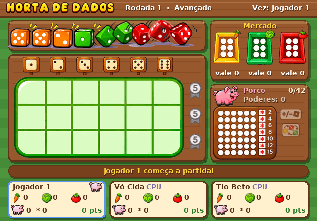
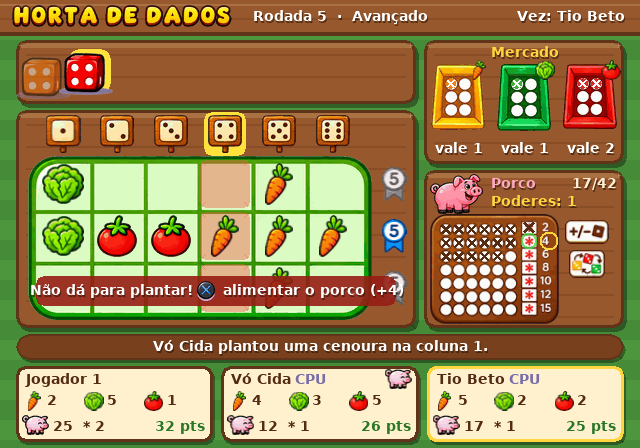
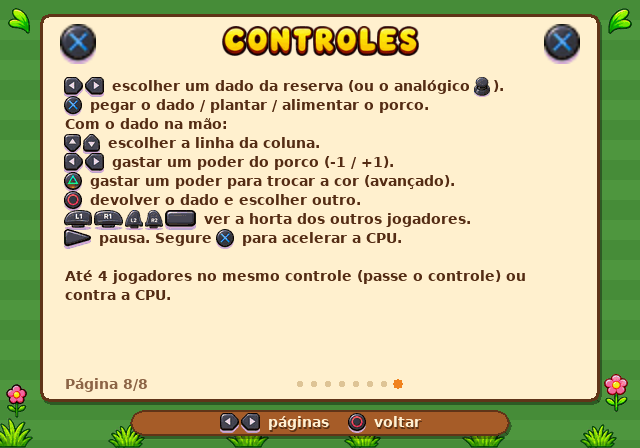
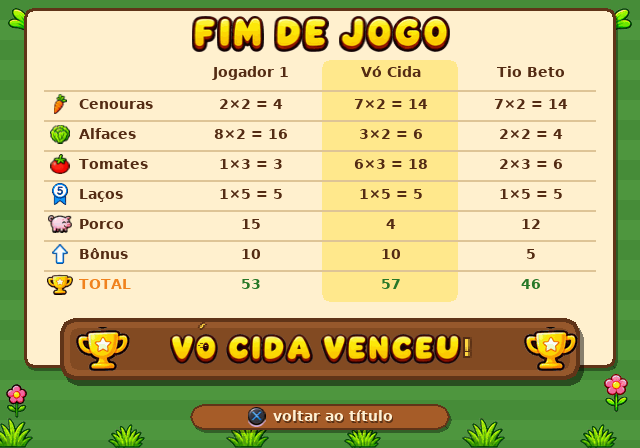
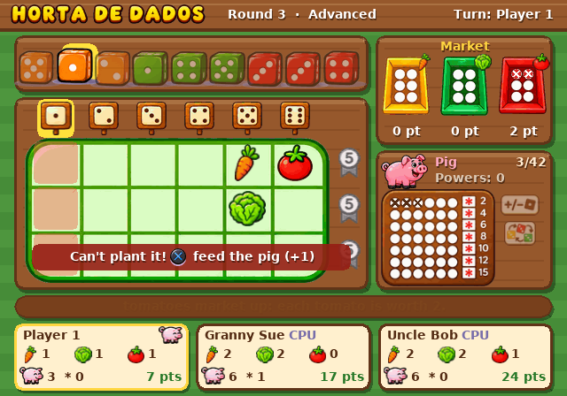
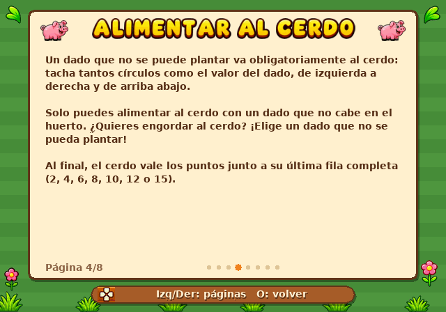

# Horta de Dados PS2

Jogo de dados e horta para **PlayStation 2** (homebrew), de 2 a 4 jogadores, humanos ou CPU.
Role os dados, plante cenouras, alfaces e tomates, engorde o seu porco e fique de olho no
mercado: o preço das verduras muda a cada rodada.

Ao ligar, o jogo mostra a arte de abertura (aperte START ou X) e depois pergunta o idioma: **Português** (padrão), **English** ou **Español**. Dá para trocar
depois pelo item *Idioma* do menu principal.











> As capturas acima saem do renderizador de testes no PC (`make -f Makefile.host shots`), que
> desenha o mesmo código de interface do jogo.

## Como jogar

| Botão | Ação |
| --- | --- |
| Direcional Esq/Dir | escolher um dado da reserva |
| X | pegar o dado / plantar / alimentar o porco |
| Cima/Baixo (com o dado na mão) | escolher a linha da coluna |
| Esq/Dir (com o dado na mão) | gastar um poder do porco: valor -1 / +1 |
| Triângulo (com o dado na mão) | gastar um poder para trocar a cor (modo avançado) |
| O | devolver o dado e escolher outro |
| L1/R1/L2/R2/SELECT | ver a horta dos outros jogadores |
| START | pausa (com "Como jogar" e "Sair") |
| Segurar X | acelera a jogada da CPU |

**Controle 1** joga só pelo jogador 1. **Controle 2** joga pelos jogadores 2, 3 e 4 (que passam
o controle 2 entre si) e não mexe no jogador 1. Na vez de cada um, o jogo avisa qual controle usar
e o placar mostra **C1**/**C2** ao lado do nome. Menus, pausa e as jogadas da CPU aceitam os dois
controles. O analógico esquerdo também serve de direcional.

### Regras

- **Rodada:** o jogador inicial rola todos os dados (9; ou 6, sendo 2 de cada cor, com 2
  jogadores). Na ordem, cada um pega 1 dado até sobrar só 1.
- **Plantar:** a cor do dado é a verdura (laranja = cenoura, verde = alface, vermelho = tomate) e o
  número é a coluna da horta (3 linhas x 6 colunas). A primeira verdura de cada tipo vai em
  qualquer espaço livre da coluna; as seguintes precisam encostar (ortogonalmente) em outra igual.
- **Porco:** um dado que não pode ser plantado vai para o porco: marca tantos círculos quanto o
  valor do dado. Só dá para alimentar o porco com dados que não podem ser plantados.
- **Poderes do porco:** cada linha de 6 círculos completa dá um poder de uso único: muda o valor do
  dado em ±1 (vários poderes podem ser somados). No modo avançado, um poder também pode trocar a cor.
- **Mercado:** o dado que sobra na reserva faz o mercado da sua cor subir um círculo para todos.
  No modo básico cada verdura vale 1 + círculos; no avançado os mercados começam em 0.
- **Fim:** quando alguém enche a horta, completa o porco (42 círculos) ou um mercado chega a 6
  círculos, a rodada atual termina e a partida acaba.
- **Pontos:** verduras x valor no mercado; 5 por linha completa da horta; o porco vale o número
  ao lado da última linha completa (2, 4, 6, 8, 10, 12, 15). No modo avançado, +5 para quem tiver
  mais cenouras, mais alfaces, mais tomates e mais círculos no porco (empates: todos ganham).
  Desempate: mais verduras plantadas, depois mais círculos no porco.

Tudo isso também está no menu **Como jogar**, dentro do jogo.

## Rodar

- **Emulador (PCSX2):** *Sistema → Iniciar ELF* (ou "Run ELF") e escolha `horta_de_dados.elf`;
  ou abra `horta_de_dados.iso` como um disco. O PCSX2 precisa de uma BIOS do seu próprio console.
- **PS2 de verdade:** copie o `horta_de_dados.elf` para um pendrive e abra pelo wLaunchELF
  (uLaunchELF), ou adicione como aplicativo no OPL. A ISO gravada em CD só dá boot em console
  desbloqueado (ex.: com FreeMcBoot/modchip).

O jogo usa NTSC 640x448 e se centraliza automaticamente em consoles PAL.

## Compilar

Precisa do [PS2SDK](https://github.com/ps2dev/ps2dev) com gsKit. O jeito mais fácil é a imagem
Docker oficial:

```sh
# com make (a imagem não traz make; instale com apk)
docker run --rm -v "$PWD":/src -w /src ps2dev/ps2dev:latest \
    sh -c "apk add --no-cache make && make"

# ou sem make
docker run --rm -v "$PWD":/src -w /src ps2dev/ps2dev:latest sh build_ps2.sh
```

Isso gera `horta_de_dados.elf`. `make iso` gera uma ISO (precisa de `mkisofs`/`genisoimage`).
O GitHub Actions (`.github/workflows/build.yml`) compila o ELF e a ISO a cada push e deixa os
arquivos como artefatos do workflow.

### Arte

As folhas em `art/` são recortadas automaticamente por `tools/genassets.py` (remove o fundo branco,
redimensiona e empacota em atlas de 8 bits com paleta de 256 cores: sprites 512x512, letras
512x128, dados 1024x512 e a abertura 640x448). Os atlas gerados já estão no repositório; só é
preciso rodar o script de novo se a arte mudar:

```sh
pip install pillow numpy scipy
python3 tools/genassets.py
```

No console os atlas viram texturas T8 com CLUT (a paleta é reorganizada no carregamento, como o
GS espera). Uso de VRAM: 2 framebuffers (~2,2 MB) + fonte 256 KB + sprites 256 KB + letras 64 KB +
dados 512 KB + abertura 280 KB + paletas ≈ 3,6 MB, dentro dos 4 MB do GS.

Nas dicas da tela e nas regras, os nomes dos botões viram ícones: nos textos de `src/lang.c` basta
escrever `{X}`, `{O}`, `{T}`, `{Q}`, `{U}`, `{D}`, `{L}`, `{R}`, `{L1}`, `{R1}`, `{L2}`, `{R2}`,
`{ST}` (START), `{SE}` (SELECT) ou `{AN}` (analógico).

### Música e efeitos sonoros

Toda a trilha é sintetizada por `tools/genaudio.py` (composições originais, tema "fazendinha"):

- **Manhã na Horta** (menus): banjo dedilhado, violão "boom-chick", baixo, violino e chocalho, 120 bpm.
- **Tarde no Campo** (partida): mais calma, banjo e assobio, 96 bpm.
- Efeitos: dados chacoalhando e caindo, plantar ("ploc" na terra), porco comendo (oinc), galo no
  início, galinha na vez do jogador, vaca na última rodada, caixa registradora no mercado, brilho
  ao ganhar poder, fanfarra de vitória, cliques de menu e erro.

As músicas ficam em µ-law de 8 bits e os efeitos em PCM de 16 bits (`assets/audio.bin`, ~2 MB).
No PS2, o `audsrv.irx` do PS2SDK vai embutido no ELF e um mixer no EE (`src/audio.c`) mistura a
música com até 8 efeitos a 22050 Hz. Para regenerar os sons: `pip install numpy scipy` e
`python3 tools/genaudio.py` (gera também prévias em `build-audio/*.wav`). O teste no PC grava o
áudio da partida roteirizada em `build-host/shots/partida.wav`.

### Testes no PC

O motor de regras e a interface são C puro, separados da camada do PS2, então rodam no PC:

```sh
make -f Makefile.host test    # testes de regras + 300 partidas simuladas só com CPU
make -f Makefile.host shots   # capturas de tela (.ppm) em build-host/shots/
```

## Estrutura

| Arquivo | Conteúdo |
| --- | --- |
| `src/game.c` | regras: dados, plantio, porco, poderes, mercado, fim de jogo, pontuação |
| `src/ai.c` | jogadores CPU (Fácil e Normal) |
| `src/ui.c` | telas, menus, fluxo da partida |
| `src/gfx.c` | desenho: texto, dados, verduras, porco, painéis |
| `src/audio.c`, `tools/genaudio.py` | mixer de áudio e síntese da música/efeitos |
| `src/lang.c` | todos os textos e regras em português, inglês e espanhol |
| `art/sheet1.png`, `art/sheet2.png` | folhas de arte originais (HUD, mascotes, letras) |
| `art/splash.png` | arte de abertura (tela inicial, idioma e menu) |
| `art/buttons.png` | ícones dos botões do controle usados nas dicas e nas regras |
| `art/dice_*.png` | animação dos dados rolando (laranja, verde, vermelho; 6 valores x 7 quadros) |
| `tools/genassets.py` | recorta as folhas de arte e gera `assets/*.bin` e `src/sprites.h` |
| `assets/*.bin`, `src/assets.S` | atlas de sprites embutidos no ELF (`.incbin`) |
| `src/plat_ps2.c`, `src/main_ps2.c` | PS2: vídeo com gsKit, controles com libpad |
| `src/font_data.c` | fonte do texto pequeno, gerada por `tools/genfont.py` (DejaVu Sans Bold) |
| `host/` | plataforma de testes no PC (renderizador por software) |
| `tests/test_rules.c` | testes das regras |

## Créditos

- Regras adaptadas do jogo de tabuleiro *Harvest Dice* (design de Danny Devine, Grey Fox Games).
  Este é um projeto de fã, sem afiliação; nome e textos do jogo são próprios.
- Arte da HUD, mascotes e letras: folhas fornecidas pelo autor do projeto (`art/`). O logotipo
  "Harvest Dice" que aparece nas folhas não é usado no jogo; o título é montado com as letras.
- Fonte: DejaVu Sans Bold (licença Bitstream Vera/DejaVu).
- Feito com PS2SDK e gsKit (ps2dev).
